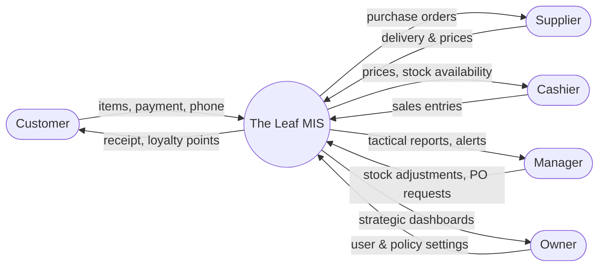
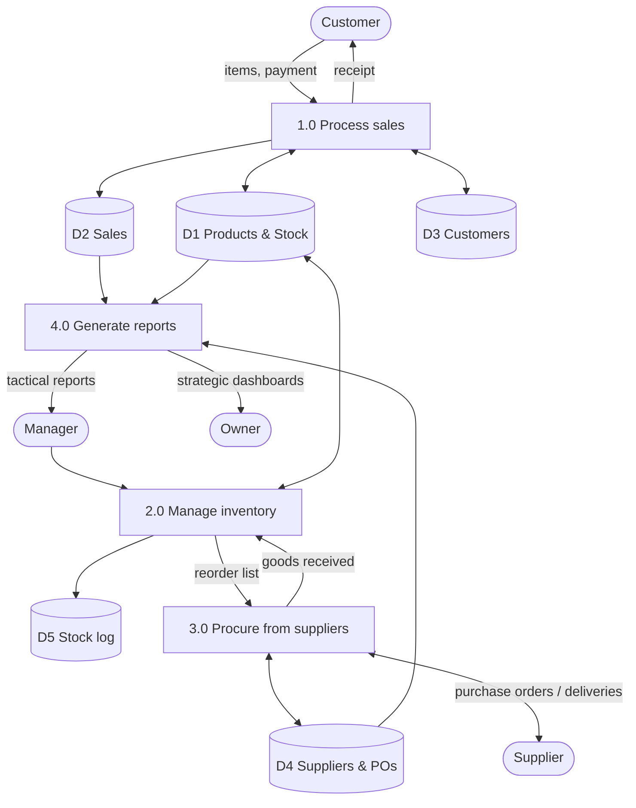
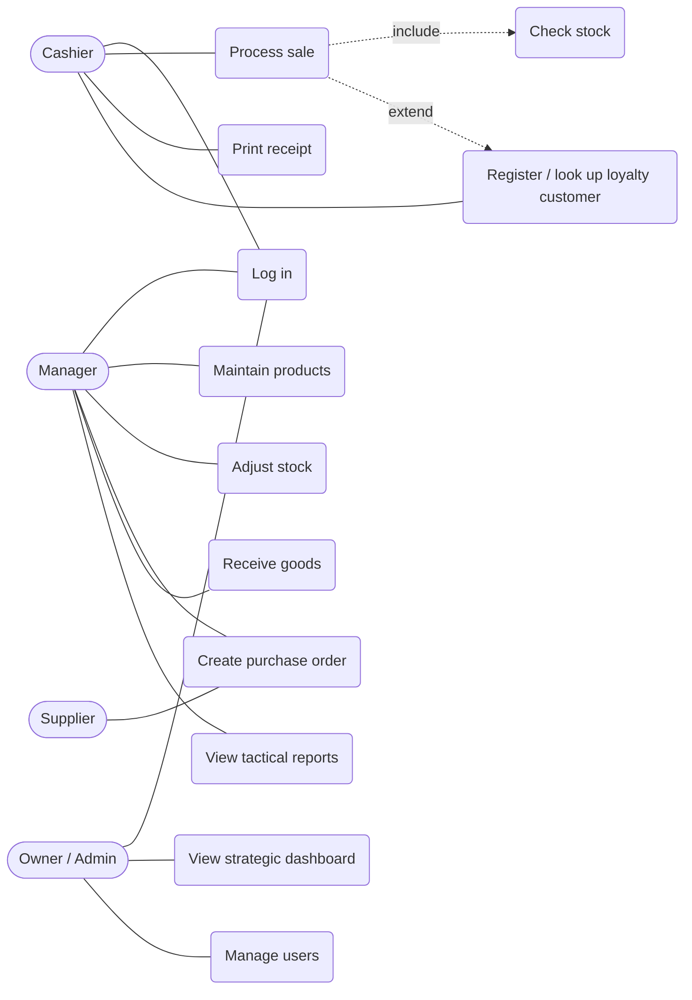
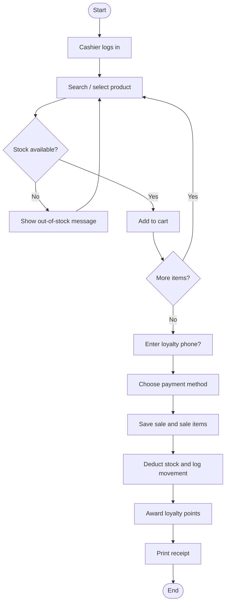
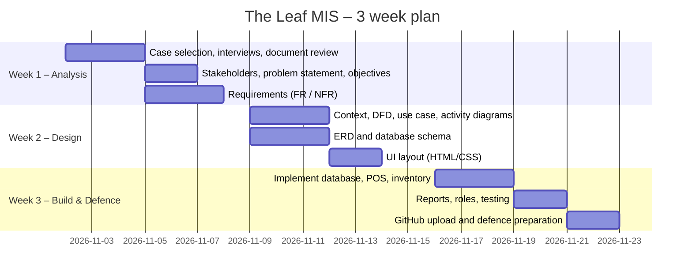

# The Leaf Supermarket – Management Information System
**BIT 2102 – Management Information Systems and Development · Semester I Examinations, November 2026**
Slogan: *“Everything you need under one leaf”*
Stack: **HTML + CSS + JavaScript** (front end) · **PHP** (server) · **MySQL** (database) · runs on **XAMPP**

## Run the prototype on XAMPP
1. Copy this folder to `C:\xampp\htdocs\leaf-supermarket` (Mac/Linux: `/opt/lampp/htdocs/leaf-supermarket`).
2. Open the **XAMPP Control Panel** and start **Apache** and **MySQL**.
3. Open **http://localhost/leaf-supermarket/setup.php** and click **Install / reset demo data**. This creates the `leaf_supermarket` database, all tables and about 4 months of sample sales.
   *(Alternative: in phpMyAdmin choose Import and select `database/leaf_supermarket.sql`.)*
4. Open **http://localhost/leaf-supermarket/** and sign in:

| Role (MIS level) | Username | Password |
|---|---|---|
| Cashier – operational | `cashier` | `cashier123` |
| Manager – tactical | `manager` | `manager123` |
| Owner/Admin – strategic | `admin` | `admin123` |

**Logo:** the picture in the top-left corner is `assets/logo.svg` (a PNG copy is `assets/logo.png`). To use a different logo, save it in `assets` and change the `logo` line in `config.php`.

Database settings are in `config.php` (XAMPP defaults: user `root`, empty password). Re-run `setup.php` any time to reset the demo data. Delete `setup.php` before putting the system on a real server.

---
# Task One – Organization analysis

## 1. The organization
**The Leaf Supermarket** is a (realistic, assumed) mid-sized supermarket in Kampala with ~15 staff, ~3,000 customers per month and about 40 product lines in the prototype (real shops stock thousands). It sells groceries, fresh produce, beverages, dairy & eggs, bakery, household and personal-care goods.
**Structure / departments:** Sales (cashiers, POS) · Inventory & Procurement (store keeper, buyer) · Finance & Administration (accountant, owner). **Current handling of information:** paper receipt books, a handwritten stock ledger, a spreadsheet for prices, and phone calls/WhatsApp to suppliers.
> *Assumption:* no single credible interview source was available, so the case is a realistic one built on typical Ugandan supermarket operations; the fact-finding below is how the real organisation would be studied.

## 2. Stakeholders and information needs
| Stakeholder | Level | Information needed |
|---|---|---|
| Cashiers | Operational | Product price & availability, receipt, customer loyalty points |
| Store keeper | Operational | Current stock, low-stock alerts, goods received |
| Store/Branch manager | Middle (tactical) | Sales by category/product, reorder list, expiry list, supplier performance |
| Owner / Director | Top (strategic) | Monthly revenue, gross profit & margin, loyalty share, staff performance |
| Customers (external) | External | Accurate receipts, loyalty points balance |
| Suppliers (external) | External | Purchase orders, quantities, delivery confirmation |
| URA / regulators (external) | External | Accurate sales and purchase records |

## 3. Activities by management level
| Level | Activities | Two decisions |
|---|---|---|
| **Operational** | Selling, receipting, stock updates | (1) Can this sale go through – is stock available? (2) Which loyalty points to award? |
| **Tactical** | Replenishment, pricing, wastage control | (1) What to reorder, from whom, how much? (2) Which near-expiry items to discount? |
| **Strategic** | Growth, profitability, supplier strategy | (1) Which categories to expand/drop based on margin? (2) Whether to invest in a second branch / loyalty campaign |

## 4. Fact-finding techniques
| Technique | Advantage | Limitation |
|---|---|---|
| Interviews (manager, cashiers, store keeper) | Rich, detailed answers; follow-up questions possible | Time-consuming; interviewees may be biased or forget details |
| Document review (receipt books, stock ledger, price lists) | Shows real, historical data and actual forms in use | Records may be incomplete, outdated or illegible |
| *(Observation of the till/stock room – optional 3rd)* | Reveals what people actually do, not what they say | Staff may behave differently when watched |

## 5. Problem statement & objectives
**Problem:** The Leaf records sales and stock on paper and spreadsheets. As a result stock-outs and expired goods are discovered late, reorder decisions are guesswork, month-end figures take days to compile and disagree between staff, and the owner has no reliable view of profit or loyal-customer value.

**Main objective:** design a prototype MIS that supports operational, tactical and strategic decisions at The Leaf.
**Specific objectives:** (1) automate sales/receipting and stock deduction; (2) alert managers to low stock and expiring goods; (3) manage suppliers and purchase orders with automatic stock receiving; (4) track loyalty customers; (5) give role-based reports and dashboards (revenue, margin, top products); (6) keep an audit trail of every stock movement.

---
# Task Two – Analysis & design

## 6. Functional requirements
| # | Requirement | Where in prototype |
|---|---|---|
| FR1 | Authenticate users and restrict features by role (cashier/manager/admin) | Login, role checks |
| FR2 | Record sales via a POS cart, compute totals, accept Cash/Mobile Money/Card | `pos.php` |
| FR3 | Print/display a receipt for every sale | `receipt.php` |
| FR4 | Automatically deduct stock on sale and block overselling | checkout |
| FR5 | Maintain products (add/edit, price, cost, reorder level, expiry) | `products.php` |
| FR6 | Alert on low stock and near-expiry products | dashboard, reports |
| FR7 | Manage suppliers and create purchase orders; receiving a PO adds stock | `suppliers.php`, `orders.php` |
| FR8 | Register loyalty customers and award 1 point per UGX 1,000 | `customers.php`, POS |
| FR9 | Record manual stock adjustments (damage, theft, count) with reason | `products.php`, `stock_log.php` |
| FR10 | Generate tactical & strategic reports (category revenue, top products, monthly profit, margin, cashier performance) | `reports.php` |
| FR11 | Manage user accounts (create, deactivate) | `users.php` |

**Non-functional requirements:** **NFR1 Security** – hashed passwords (PHP `password_hash`), role-based access, sessions, CSRF tokens, prepared SQL statements. **NFR2 Performance** – any page loads in under 2 seconds with 100k sale lines (indexed tables). **NFR3 Usability** – works on tablets/phones, a cashier can complete a sale in under 30 seconds with minimal training. **NFR4 Reliability/integrity** – foreign keys, CHECK constraints, no negative stock, transactions for sales and stock receiving, daily database backup (export from phpMyAdmin). **NFR5 Localisation** – UGX currency and Uganda mobile money support.

## 7. Context diagram


## 8. Level-0 DFD


## 9. Use case diagram


## 10. Activity diagram – "Process a sale"


## 11. Entity Relationship Diagram (10 entities)

```mermaid
erDiagram
  USERS ||--o{ SALES : records
  USERS ||--o{ PURCHASE_ORDERS : raises
  USERS ||--o{ STOCK_ADJUSTMENTS : makes
  CUSTOMERS |o--o{ SALES : "earns points on"
  SALES ||--|{ SALE_ITEMS : contains
  PRODUCTS ||--o{ SALE_ITEMS : "sold as"
  CATEGORIES ||--o{ PRODUCTS : groups
  SUPPLIERS ||--o{ PRODUCTS : supplies
  SUPPLIERS ||--o{ PURCHASE_ORDERS : receives
  PURCHASE_ORDERS ||--|{ PO_ITEMS : contains
  PRODUCTS ||--o{ PO_ITEMS : ordered_as
  PRODUCTS ||--o{ STOCK_ADJUSTMENTS : changes
  USERS { int user_id PK
    string full_name
    string username
    string role }
  CATEGORIES { int category_id PK
    string name }
  SUPPLIERS { int supplier_id PK
    string name
    string phone }
  PRODUCTS { int product_id PK
    string sku
    int category_id FK
    int supplier_id FK
    real cost_price
    real selling_price
    int stock_qty
    int reorder_level
    date expiry_date }
  CUSTOMERS { int customer_id PK
    string phone
    int loyalty_points }
  SALES { int sale_id PK
    int user_id FK
    int customer_id FK
    real total
    string payment_method }
  SALE_ITEMS { int item_id PK
    int sale_id FK
    int product_id FK
    int qty
    real unit_price
    real unit_cost }
  PURCHASE_ORDERS { int po_id PK
    int supplier_id FK
    int user_id FK
    string status
    real total_cost }
  PO_ITEMS { int po_item_id PK
    int po_id FK
    int product_id FK
    int qty
    real unit_cost }
  STOCK_ADJUSTMENTS { int adj_id PK
    int product_id FK
    int user_id FK
    int change_qty
    string reason }
```


## 12. Three-week project schedule


## 13. Project structure
```
index.php, login.php, dashboard.php ...   one PHP page per screen (HTML + PHP)
checkout.php                              JSON endpoint used by the POS (saves sale, deducts stock in one transaction)
includes/bootstrap.php                    database (PDO), sessions, CSRF, role checks, helpers
includes/layout.php                       shared page layout and navigation
includes/seed.php, setup.php              installer that builds the database and sample data
database/schema.sql                       MySQL design (10 tables)
database/leaf_supermarket.sql                 ready-made export for phpMyAdmin
assets/style.css                          CSS styling
assets/pos.js, assets/app.js              JavaScript (POS cart, live table filter)
config.php                                database connection settings
```
*Prototype limitations (state at defence):* single branch, no returns/refunds module, no automatic backups, setup.php must be removed in production.
